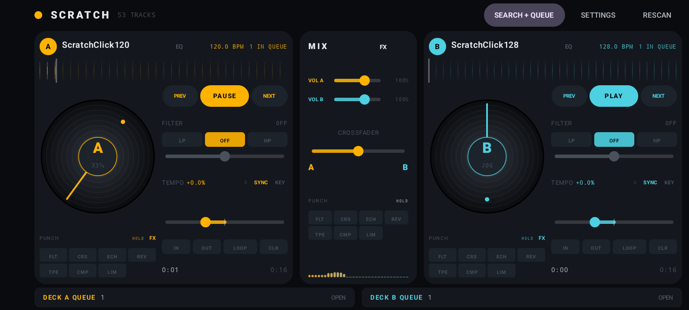
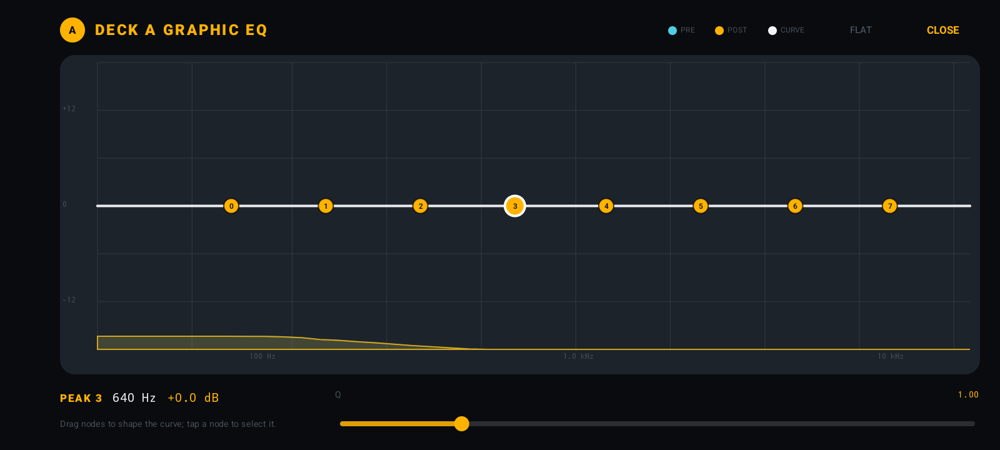
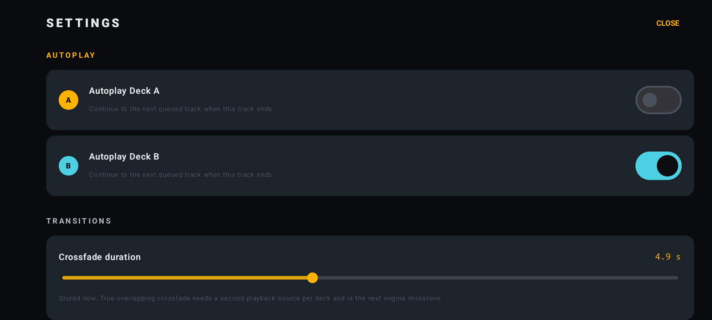
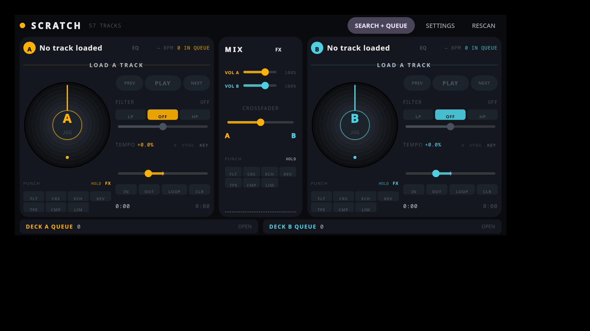
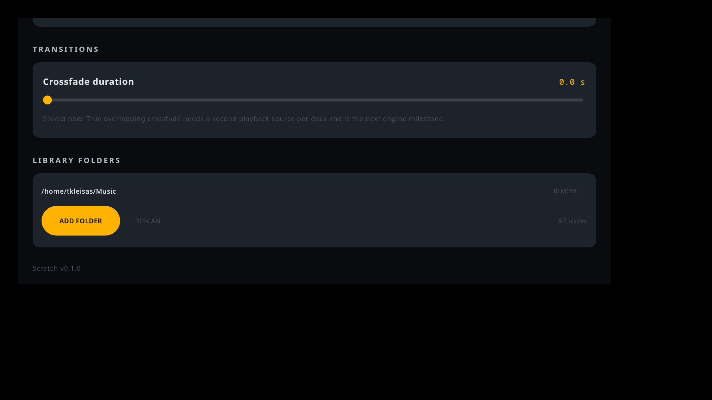

# Scratch

Scratch is a vinyl-first two-deck DJ app for Android and Linux desktop. The Android UI is Jetpack Compose over a native C++ engine on [Oboe](https://github.com/google/oboe); the desktop app is Compose Multiplatform over a native ALSA engine. Both share the same Kotlin domain models and DSP.

**Android package:** `com.tkleisas.scratchdj`

Android page: <https://tkleisas.github.io/scratch/> · Privacy: <https://tkleisas.github.io/scratch/privacy/>









## Status

This is an early development build, exercised on a physical Android 15 device and Ubuntu 24.04. The core two-deck engine, scratching, MP3/FLAC/OGG decoding, tempo/key lock, filters, loops, library search, and queues are working on both platforms.

### Working today

- Immersive full-screen landscape UI with dual rotating platters, waveforms, and a center mixer.
- Oboe audio engine: one 48 kHz float output stream, low-latency performance mode, exclusive mode attempted first with shared-mode fallback, and automatic stream reopen after device disconnects.
- Android audio focus and a foreground playback service with an ongoing notification and Pause action; playback keeps running when the app is backgrounded.
- WAV and AIFF/AIFC (uncompressed) playback: 8/16/24/32-bit PCM, 32-bit float WAV, mono or stereo, including AIFC `NONE`/`sowt`.
- MP3, FLAC, OGG/Vorbis, and Opus decoding through `MediaExtractor` + `MediaCodec`.
- Long compressed tracks are decoded once into a 16-bit stereo PCM cache, then memory-mapped into the native engine. A 59:57 mix works with instant seeking and scratching anywhere in the track; the cache is reused on later loads.
- Decode progress is shown on the deck while the cache is being built.
- Key lock works at source rates that differ from the engine rate (e.g. 44.1 kHz into a 48 kHz engine) by resampling into the stretcher natively.
- Load-time cubic resampling for WAV/AIFF.
- Vinyl scratching: dragging the platter drives a variable-rate read head with cubic interpolation, reverse playback, rate smoothing, and start/end clamping.
- When paused, the platter acts as a jog wheel: it moves the playhead silently.
- Tempo slider (50%–200%) with optional key lock. Key lock uses WSOLA time-stretching; without key lock, tempo changes repitch the track like a turntable.
- Per-deck filter with explicit LP / OFF / HP buttons and a logarithmic 20 Hz–20 kHz cutoff slider, smoothed every 16 samples. Center OFF is a true bypass.
- Per-deck 8-node graphical EQ: draggable low shelf, six peaks, and high shelf, each up to ±18 dB, with per-node Q. The editor draws the live magnitude curve plus pre-EQ and post-EQ spectra. FLAT resets gains, BYPASS removes the EQ from the chain while preserving settings, and named presets are saved to SQLite and can be loaded on either deck. EQ runs before the DJ filter.
- Master 32-band logarithmic spectrum analyzer in the mixer strip, fed from the final mixed output.
- Soft-knee master ceiling avoids hard digital clipping on hot mixes. Oboe stream errors reopen the output on the current default device.
- Equal-power crossfader with per-sample gain ramps.
- Per-deck channel volume in the mixer strip, from 0% to 150%, with independent A/B sliders.
- Per-deck transport: PREV, PLAY/PAUSE, NEXT. NEXT pulls from the deck queue and is disabled when there is no next track; the next compressed queue track is prefetched into the PCM cache in the background. PREV uses per-deck play history.
- BPM analysis on first load using a native onset/flux detector, persisted in SQLite. BPM is shown in the deck header and search results.
- Tempo SYNC matches the other deck’s effective BPM (including its tempo shift) and enables key lock automatically. Missing BPMs are analyzed on demand when SYNC is pressed, with progress and result feedback.
- Tempo reset: tap the `0` next to SYNC to return pitch to 0% instantly.
- Looping: one-tap LOOP creates and enables a 4-second loop at the playhead. IN sets the loop start without engaging the loop; OUT sets the end and starts looping. CLR clears. A pending IN point is drawn on the waveform. Key-locked playback wraps the stretcher source at the loop seam instead of resetting it, so loops stay continuous.
- Per-rack FX: Deck A, Deck B, and Master each have an **FX** button in their header (the master button is in the mixer header), an ordered **INSERT** chain, and seven independent **PUNCH** sends. Effects are Filter, Crush, echo, plate reverb, tape emulation, compressor, and limiter. Each rack has an FX overlay with INSERT/PUNCH tabs, up/down ordering, enable/disable, full parameters, and automatic persistence. Punch pads sit below each platter and in the master mixer; they support hold and latch modes, and echo/reverb tails continue after release. Insert chains run post-fader so tails survive crossfader moves. Echo tempo sync follows the effective BPM of its rack's deck (the master rack follows the active crossfader side).
- Waveforms computed from 2048 peak buckets at load and normalized for display.
- Local library indexed into SQLite, with case-insensitive title/artist/album search and escaped SQL wildcards.
- Search overlay with one-tap add to Deck A or Deck B queues.
- Per-deck queues are persistent playlists with a cursor: playing a track no longer removes it, and PREV/NEXT move backward/forward through the queue. The current track is highlighted in the queue overlay.
- Queue lists can be saved as named presets (Deck A, Deck B, or A+B) in SQLite and reloaded later. Loading A-only or B-only preserves the other deck’s queue.
- Settings screen with persisted Autoplay Deck A and Autoplay Deck B toggles, plus a persisted crossfade-duration value. Autoplay controls whether the deck advances to the next queued track at the end.
- Tap the waveform to seek.

### Desktop (Linux / Windows)

- Compose Multiplatform desktop UI with the same two-deck layout and controls as Android.
- Linux uses a native ALSA engine at 48 kHz s16; Windows uses a native PortAudio backend with WASAPI exclusive mode and shared-mode fallback (48 kHz float, 256-frame default buffer).
- Windows is built in two flavors: the default MSI uses WASAPI exclusive/shared mode; the ASIO MSI enables PortAudio ASIO and prefers the default ASIO device, falling back to WASAPI when no ASIO driver is available. Build the ASIO flavor with `SCRATCH_ASIO=1` (or `-Pscratch.asio=true`). A device picker is still to come.
- The same deck, scratch, tempo/key-lock, filter, EQ, loop, crossfader, volume, FX racks, and spectrum behavior is used on both desktops.
- FFmpeg-backed decoding into a disk PCM cache (`~/.cache/scratch/pcm` on Linux, `%LOCALAPPDATA%\scratch\pcm` on Windows), including WAV/AIFF and compressed formats. FFmpeg must be installed or supplied via `SCRATCH_FFMPEG`.
- Library folders are configurable in **Settings → Library Folders** and persisted with `java.util.prefs`; the default is `~/Music`.
- Desktop EQ and queue presets persist in `~/.config/scratch/presets.bin`.
- Debian and Windows MSI packages build with the native engine bundled into app resources and extracted/loaded at runtime; an AppImage target is configured but not yet exercised in CI.



### Google Play assets

Play Store copy, data-safety answers, and upload-ready graphics are in
[`store/android/`](store/android/):

- `listing.md` — app name, short/full descriptions, release notes
- `data-safety.md` — Play Console Data safety answers
- `graphics/icon-512.png` and `graphics/feature-graphic-1024x500.png`
- `screenshots/phone/`, `screenshots/tablet-7/`, and `screenshots/tablet-10/`

### Known limitations

- WAV/AIFF tracks are still parsed and held in memory; only compressed formats use the disk-backed cache yet.
- The first load of a very long compressed track takes time (about two minutes for an hour-long MP3 on the test phone) while it decodes into the cache. Subsequent loads are fast. The PCM cache is capped at 3 GB and pruned at startup.
- BPM is analyzed the first time a track is loaded, or on demand when SYNC is pressed. It is not a full library pre-analysis pass yet. Tempo SYNC does not phase/downbeat-align decks yet; beatgrid sync is next.
- Cue points, hot cues, and slip mode are not implemented.
- Playback notifications currently expose Pause/stop only; a full media session with lock-screen controls and resume is not implemented.
- True overlapping crossfade is not implemented yet; the crossfade duration is persisted, but it needs a second playback source per deck. Autoplay currently advances with the deck’s normal fade-in.
- Reported latency on the test phone varies between roughly 40–125 ms depending on the callback; Bluetooth output is not suitable for DJ use.
- The search keyboard floats over the results on some IMEs; the A/B queue buttons are deliberately kept on the left so they stay reachable.
- Linux audio targets ALSA only; Windows uses WASAPI/ASIO. JACK/PipeWire routing is not implemented.
- The desktop UI is adapted from the Android UI rather than rendered from a shared Compose module yet.
- The release workflow publishes a debug-signed APK until Android release signing secrets are configured; the locally signed AAB is built with the key in `~/.volna/keystore.properties`.
- Punch effects use a hybrid topology: Echo, Reverb, Filter, Crush, and Tape are parallel sends (tails survive pad release), while Compressor and Limiter use a serial insert path so punching them changes the main signal's dynamics. Punch sends tap the signal after the INSERT chain, so insert effects color the punch sound. PUNCH ordering controls pad layout and the serial order of punched dynamics; the INSERT chain order controls the always-on serial chain.
- FX parameters are applied per audio block; automation, modulation, and named FX presets are not implemented yet.

## Controls

| Control | Action |
| --- | --- |
| Platter | While playing: scratch/nudge/spin back. While paused: jog the playhead silently. |
| PREV | Load the previous track from this deck's history, or restart if history is empty. |
| PLAY/PAUSE | Start or stop the deck. |
| NEXT | Load and play the next queued track. Disabled when the queue has no next track; the next compressed track is prefetched. |
| Waveform | Tap to seek. Loop region is highlighted when active. |
| LP / OFF / HP | Select the filter type explicitly. |
| FILTER slider | Cutoff from 20 Hz to 20 kHz, logarithmic. |
| EQ | Open the graphical EQ editor; drag nodes for frequency/gain, select a peak for Q, FLAT resets gains. |
| FX (deck/master) | Open that rack's FX overlay. INSERT edits the serial chain; PUNCH edits the ordered pad rack. |
| PUNCH pads | Hold (or latch) a pad to send the selected rack through that effect. |
| Spectrum | Master mix spectrum in the mixer; pre/post deck spectra in the EQ editor. |
| SETTINGS | Autoplay A/B and crossfade-duration settings; on desktop, also library folders. Persisted across launches. |
| TEMPO | 50%–200% playback rate. Tap `0` to reset to 0%. |
| SYNC | Match the other deck’s effective BPM, analyze BPM on demand if needed, and enable key lock. |
| KEY | Enables WSOLA key lock; tempo changes no longer repitch. |
| VOL A / VOL B | Per-deck output volume (0%–150%). |
| IN | Set the loop start at the current playhead without starting the loop. |
| OUT | Set the loop end at the current playhead and start looping. |
| LOOP | Toggles the loop. With no loop points, creates and enables a 4-second loop at the playhead. |
| CLR | Clears loop points and disables looping. |
| HOLD / LATCH | Pad behavior in the FX overlay. HOLD is momentary; LATCH taps to toggle. |
| CROSSFADER | Equal-power mix between Deck A and B. |
| SEARCH + QUEUE | Search the SQLite index and add results to either deck queue. |
| Queue bar | Open a deck queue; play or remove tracks, navigate with PREV/NEXT, and save/load A, B, or A+B queue presets. |

## Architecture

```
shared/src/commonMain/kotlin/com/tkleisas/scratchdj/
  model/                   Deck/side/queue state shared by Android and desktop
  audio/                   Sync math and preset codecs
  data/                    Shared queue and EQ preset models
app/src/main/java/com/tkleisas/scratchdj/
  MainActivity.kt          Full-screen activity, permissions, lifecycle
  DjController.kt          UI state, library sync, queues/history, engine polling
  audio/DjEngine.kt        JNI facade
  audio/PcmDecoder.kt      MediaExtractor/MediaCodec decode
  audio/PcmCache.kt        Disk-backed PCM cache and pruning
  data/SettingsStore.kt    Persisted autoplay/crossfade settings
  data/QueuePresetStore.kt SQLite queue-list presets
  audio/SyncMath.kt        Tempo-sync ratio math
  data/                    MediaStore scan, SQLite DB, repository, queue
  model/                   DeckSide, DeckUiState
  ui/                      Compose screens, platters, waveforms, FX overlay/pads
  PlaybackService.kt       Foreground playback notification and audio focus
app/src/main/cpp/
  jni_bridge.cpp           JNI entry points and engine lifetime
  audio/AudioEngine.*      Oboe stream, mixing, crossfader, mastering
  audio/Deck.*             Transport, scratch/jog, tempo/key lock, filters, loops
  audio/TrackLoader.*      WAV/AIFF parsing, resampling, PCM16/mmapped track builder
  audio/BpmAnalyzer.*      Onset/flux BPM estimation over any track source
  audio/FxRack.*           Per-rack insert chains and independent punch sends
  audio/SpectrumAnalyzer.* Master and per-deck FFT spectrum analyzers
  audio/Svf.h              State-variable DJ filter
  audio/EqualPower.h       Crossfader law
  third_party/yawn/        Vendored MIT DSP and YAWN effects
app/src/test/cpp/          Host GoogleTest suite for native DSP
app/src/test/java/         JVM unit tests
app/src/androidTest/       Device SQLite, decoder, and native PCM tests
desktopApp/
  src/main/kotlin/         Desktop controller, scanner, FFmpeg cache, settings, Compose UI
  native/audio/            ALSA AudioEngine and JNI bridge build
  src/test/                Desktop preset persistence tests
```

The Compose layer polls `DjEngine` every 33 ms for transport state; all sample-rate work, scratching, filtering, time-stretching, and looping happens on the native audio thread. Track loading, MediaStore scanning, and compressed decoding run on `Dispatchers.IO`. Track data is handed to the audio thread through a mutex-protected pending slot that the callback claims with `try_lock`, so the audio thread never blocks on file I/O or decoding.

WAV/AIFF files are parsed and resampled natively into float samples. Compressed formats are decoded to a source-rate 16-bit stereo PCM cache file in Kotlin, then memory-mapped into the native engine with JNI. The native deck reads float, heap PCM16, or mapped PCM16 through the same interpolation path, so scratch/jog/seek work across the whole track without loading it into RAM. The decoder fast-path writes MediaCodec PCM straight to disk when the output is 16-bit stereo, and falls back to conversion/resampling otherwise.

The SQLite schema stores one row per MediaStore audio item:

```sql
CREATE TABLE tracks (
    id INTEGER PRIMARY KEY,
    title TEXT NOT NULL,
    artist TEXT NOT NULL,
    album TEXT NOT NULL,
    display_name TEXT NOT NULL,
    extension TEXT NOT NULL,
    duration_ms INTEGER NOT NULL,
    uri TEXT NOT NULL
);
```

Title and artist are indexed, and search uses `LIKE ... ESCAPE '\'` with user wildcards escaped.

## Reused DSP

The `app/src/main/cpp/third_party/yawn/` directory contains code copied from [YAWN](https://github.com/tkleisas/yawn) (MIT licensed, same author):

- `audio/TimeStretcher.{h,cpp}` — WSOLA, phase vocoder, and PGHI time-stretching. Scratch uses WSOLA for key lock.
- `audio/TransientDetector.{h,cpp}` — onset/transient detection and BPM estimation.
- `audio/AudioBuffer.h` — buffer type used by the detector.
- `audio/Oversampling.h` — 2× oversampling used by the nonlinear effects.
- `effects/Biquad.h` — reusable biquad used by EQ, filters, and effects.
- `effects/Filter.*`, `effects/Delay.*`, `effects/PlateReverb.*`, `effects/TapeEmulation.*`, `effects/Compressor.*`, `effects/Limiter.*` — the FX processors.
- `effects/Bitcrusher.h`, `effects/FreqMap.h` — crusher and log-frequency helpers.
- `effects/AudioEffect.h`, `core/ParameterInfo.h`, `core/WidgetHint.h` — minimal compatibility shims replacing YAWN's DAW/UI effect base.
- `LICENSE.txt` — YAWN's MIT license.

Two minimal compatibility edits were applied: the vendored headers reference YAWN's `kDefaultSampleRate` constant, so the defaults were changed to `48000.0` to keep the files self-contained.

Limiter and TapeEmulation are now wired into both the per-rack INSERT chains and the PUNCH sends, alongside Filter, Crush, Echo, and Plate Reverb.

## Build

Requirements:

- JDK 17 or newer.
- Android SDK with API 36, build-tools, platform-tools.
- NDK `27.2.12479018` (or adjust the installed NDK).
- CMake `3.22.1`.
- Gradle wrapper `8.12` (included).

Set the SDK path in `local.properties` (not committed):

```properties
sdk.dir=/path/to/Android/Sdk
```

Build and install the Android app:

```bash
export JAVA_HOME=/path/to/jdk17
./gradlew assembleDebug
adb install -r app/build/outputs/apk/debug/app-debug.apk
```

## Android release

The Play Store package is `com.tkleisas.scratchdj`. Release builds enable R8
minification, resource shrinking, and 16 KB native-page alignment. The signing
key is read from `keystore.properties` in the project root, or from
`~/.volna/keystore.properties` (the local Volna key used for this prototype).
Neither file is committed.

```bash
export JAVA_HOME=/path/to/full-jdk17
./gradlew :app:assembleRelease :app:bundleRelease
```

- Signed APK: `app/build/outputs/apk/release/app-release.apk`
- Signed AAB: `app/build/outputs/bundle/release/app-release.aab`

Verify 16 KB page-size support before uploading:

```bash
./scripts/check_16kb_page_size.sh \
  app/build/outputs/apk/release/app-release.apk \
  app/build/outputs/bundle/release/app-release.aab
```

The AAB is the Google Play upload artifact. The CI release workflow still
publishes the debug APK until release signing secrets are configured for this
repository; the local signed AAB is the Play build.

The desktop build additionally needs a full JDK (not just a JRE), CMake, ALSA headers, and FFmpeg:

```bash
sudo apt install cmake libasound2-dev ffmpeg
export JAVA_HOME=/path/to/full-jdk17
export JAVA_INCLUDE_PATH="$JAVA_HOME/include"
./gradlew :desktopApp:run
```

`JAVA_INCLUDE_PATH` must point at a directory containing `jni.h`; Android Studio's JBR may not include it. If it is not under `$JAVA_HOME/include`, pass `-PjniInclude=/path/to/jdk/include`. Set `JAVA_HOME` to a full JDK 17 installation for `jpackage`.

### Windows build

Windows builds require JDK 17, CMake, Visual Studio Build Tools (C++), and FFmpeg in `PATH` (or `SCRATCH_FFMPEG`). From a Windows shell:

```powershell
.\gradlew.bat :desktopApp:test :desktopApp:packageMsi
```

The MSI is written under `desktopApp/build/compose/binaries/main/msi/`.

Optional ASIO support:

```powershell
$env:SCRATCH_ASIO = "1"
.\gradlew.bat :desktopApp:packageMsi
```

PortAudio downloads the current ASIO SDK at configure time when ASIO is enabled. Steinberg now dual-licenses the ASIO SDK under GPLv3 or a proprietary license; Scratch is GPLv3, so the GPLv3 option is compatible. If ASIO is advertised, follow Steinberg's trademark/logo guidelines and include: “ASIO is a registered trademark of Steinberg Media Technologies GmbH.”

The Gradle task builds `desktopApp/native` with CMake and sets `java.library.path` automatically. Build a Debian package:

```bash
./gradlew :desktopApp:packageDeb
# desktopApp/build/compose/binaries/main/deb/scratch_*.deb
```

## Tests

This project is developed test-first where the code allows it.

Native DSP and file parsing (55 GoogleTest cases):

```bash
cmake -S app/src/test/cpp -B build/native-tests -DCMAKE_BUILD_TYPE=Debug
cmake --build build/native-tests -j
ctest --test-dir build/native-tests --output-on-failure
```

The native suite covers WAV/AIFF parsing, truncation and wildcard cases, resampling, decoded PCM16 and mmap-backed tracks, scratch/jog behavior, key-lock tempo and reverse scratch, key lock at mismatched source rates, filter attenuation and bypass, EQ attenuation, bypass and response curves, loop wrapping, crossfader law, BPM detection, spectrum band mapping, the per-rack FX bypass/filter/punch-tail behavior, serial punch limiter behavior, key-lock loop continuity, crossfader gain ramps, and the vendored YAWN time-stretcher/transient detector.

JVM unit tests (34 JUnit cases):

```bash
./gradlew testDebugUnitTest
```

Covers scratch angular-velocity math, format detection, persistent queue navigation and peeking, SQL LIKE escaping, time formatting, tempo-sync ratios, EQ preset serialization, and FX preset serialization.

Device tests (18 cases, real device or emulator):

```bash
./gradlew connectedDebugAndroidTest
```

Covers SQLite track search/BPM/EQ/queue preset persistence, SharedPreferences settings persistence, the MediaCodec MP3 decode, in-memory and disk-cache decoding, mmap-backed JNI loading, waveform generation, and native BPM analysis. Note that `connectedDebugAndroidTest` may uninstall the app when it finishes; reinstall the debug APK afterwards.

Desktop JVM tests (3 cases):

```bash
./gradlew :desktopApp:test
```

Covers desktop EQ/queue preset file persistence and corrupt-file recovery.

## Continuous integration

`.github/workflows/ci.yml` runs on pushes, pull requests, and `v*` tags:

- Android: native GoogleTest suite, JVM unit tests, debug APK, and NDK/CMake build.
- Desktop: desktop JVM tests and a Debian package built against ALSA.
- Tags: publish a GitHub release with the debug APK and `.deb` once both jobs pass.

Both jobs pin JDK 17, Android SDK 36, and NDK `27.2.12479018`.

## Roadmap

1. Extract the Compose deck UI into a shared `:ui` Compose Multiplatform module so Android and desktop run the exact same screen code.
2. Full-library background analysis, beatgrid/downbeat detection, and phase-aligned SYNC.
3. Cue points, hot cues, and slip mode.
4. FX presets and automation; embedded libav, JACK/PipeWire backend, and AppImage/Flatpak packaging.
5. Disk-backed WAV/AIFF support and a cache-size/usage UI.
6. Full media session and lock-screen/resume notification controls.
7. Master limiter, vinyl wow/flutter, and better anti-aliasing at extreme scratch rates.
8. Latency measurement and device-specific audio tuning.

## Versioning

Versions are derived from annotated git tags of the form `vX.Y.Z`:

- Exact tag: `versionName = X.Y.Z`
- Commits after the tag: `X.Y.Z+N.gHASH`, where `N` is commits since the tag
- Dirty working tree: appends `.dirty` build metadata
- `versionCode = major*10,000,000 + minor*100,000 + patch*1,000 + min(commitsSinceTag, 999)`

The version is shown in the Settings screen and used by both the Android and desktop builds. The first release is tagged `v0.1.0`.

To cut a release:

```bash
git tag -a v0.1.1 -m "Scratch v0.1.1"
git push origin v0.1.1
```

## Privacy

Scratch is local-first. The Android app does not collect, transmit, sell, or share personal data and has no network permission. Library metadata, settings, FX state, and decoded PCM caches stay on the device. The public policy for the Android release is at <https://tkleisas.github.io/scratch/privacy/>.

## License

Scratch is released under the GNU General Public License, version 3 or later. See [LICENSE](LICENSE).

Vendored YAWN DSP is MIT licensed; its license is preserved at `app/src/main/cpp/third_party/yawn/LICENSE.txt`. Oboe is Apache 2.0, and AndroidX/Compose libraries are Apache 2.0.
